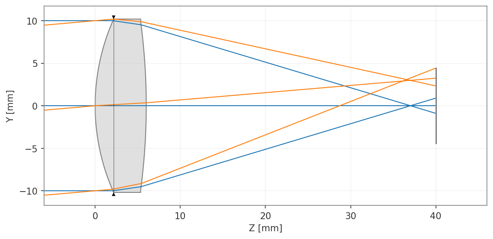

[](https://www.optiland.org/docs/)
[](https://codecov.io/github/optiland/optiland)
[](https://qlty.sh/gh/optiland/projects/optiland)

[](https://opensource.org/licenses/MIT)
[](https://doi.org/10.5281/zenodo.14588961)
[](https://doi.org/10.21105/joss.11170)
[](https://img.shields.io/badge/python-3.11%20%7C%203.12%20%7C%203.13%20%7C%203.14%20-blue)


<div align="center">
  <a href="https://www.optiland.org/docs/">
    
  </a>
</div>

<div align="center">
    
</div>

<p align="center"><em>The Optiland GUI showing a reverse telephoto system.</em></p>


## Introduction

**Optiland** is an open-source optical design package written in Python. You can use it to design, analyze and optimize everything from a single lens to a freeform three-mirror telescope, and do it in a notebook or a script.

It does what you would expect from a lens design program: sequential ray tracing, paraxial and aberration analysis, wavefront, PSF and MTF calculations, local and global optimization, tolerancing, and glass selection with GlassExpert. Because it is plain Python, it also fits into research code. The same model runs on a **NumPy** backend for everyday CPU work or a **PyTorch** backend, which adds GPU acceleration and makes every ray trace differentiable.

With Optiland you can:

- ⚙️ Build refractive and reflective systems with a small, object-oriented API
- 🔍 Trace rays through spheres, conics, aspheres, freeforms, gratings and more
- 📊 Analyze first-order properties, aberrations, wavefronts, PSFs, MTFs and scatter
- 🧠 Optimize with classic merit functions or with gradients from autograd
- 🎨 Visualize in 2D (Matplotlib) and 3D (VTK), or explore designs in the desktop GUI

Optiland is developed in the open by optical engineers, researchers and students, and new contributors are always welcome (see [Get Involved](#-get-involved)).

## Get started in 5 minutes

```bash
pip install optiland
```

Copy-paste the following to build a singlet, trace it, and draw it:

```python
from optiland.optic import Optic

lens = Optic()
lens.surfaces.add(index=0, thickness=float("inf"))                                     # object
lens.surfaces.add(index=1, radius=25.0, thickness=6.0, material="N-BK7", is_stop=True)  # front
lens.surfaces.add(index=2, radius=-75.0, thickness=34.0)                               # back
lens.surfaces.add(index=3)                                                             # image
lens.set_aperture(aperture_type="EPD", value=20)
lens.fields.set_type("angle")
lens.fields.add(y=0)
lens.fields.add(y=5)
lens.wavelengths.add(value=0.587, is_primary=True)

lens.draw()                       # 2D layout with traced rays
print(lens.paraxial.f2())         # effective focal length -> 37.04 mm
```

<div align="center">
  
</div>

Stuck? `from optiland.diagnostics import check_system; print(check_system(lens))` reports what
is missing or inconsistent about a system, each finding with a runnable fix.

→ [Start Here](https://www.optiland.org/docs/start_here.html) · [Conventions](https://www.optiland.org/docs/conventions.html) · [How do I …?](https://www.optiland.org/docs/how_do_i.html) · [5-minute quickstart](https://www.optiland.org/docs/quickstart.html) · [Example Gallery](https://www.optiland.org/docs/gallery/introduction.html) · [Full Learning Guide](https://www.optiland.org/docs/learning_guide.html)


## Installation

Optiland supports Python 3.11 to 3.14.

```bash
pip install optiland            # core package (NumPy backend)
pip install optiland[gui]       # + the desktop GUI
pip install optiland[torch]     # + CPU-only PyTorch for the differentiable backend
```

**GPU support.** Install Optiland, then a CUDA build of PyTorch that matches your driver. For example, for CUDA 12.6:

```bash
pip install optiland
pip install torch --index-url https://download.pytorch.org/whl/cu126
```

The [PyTorch installation selector](https://pytorch.org/get-started/locally/) tells you the right command for your system. On Apple Silicon or a non-NVIDIA GPU, use the CPU-only install above.

Prefer not to install anything yet? [Try Optiland in your browser](https://www.optiland.org/docs/try_it.html). The [installation guide](https://www.optiland.org/docs/installation.html) covers conda, building from source and troubleshooting.

## Core Capabilities

| Feature       | Capabilities |
|------------------------|--------------|
| **🛠️ Design & Modeling** | Configure fields, wavelengths, apertures. Build systems using spherical, aspheric, conic, and freeform surfaces.  |
| **🧮 Differentiable Core** | Switch between NumPy (CPU) and PyTorch (GPU/autograd) seamlessly for hybrid physics-ML workflows. |
| **🔬 Ray Tracing** | Trace paraxial and real rays through sequential systems with support for polarization, birefringence, and coatings. |
| **💡 Non-Sequential (pre-release)** | Differentiable non-sequential ray tracing: illumination, stray-light & ghost analysis, coatings, and absorption, optimizable via `loss.backward()`. |
| **👻 Multi-Sequence Tracing (beta)** | Trace ghost paths, reverse traces, and sub-component views as ordered sub-sequences over the same surfaces. Geometry and materials stay linked to the base system. |
| **📊 Optical Analysis** | Generate spot diagrams, wavefront error maps, ray fans, PSF/MTF plots, Zernike decompositions, distortion plots, etc. |
| **🧠 Optimization** | Local & global optimizers, autograd support, operand-based merit functions, and GlassExpert for categorical variable search. |
| **📈 Tolerancing** | Monte Carlo and parametric sensitivity analysis to evaluate robustness and manufacturability. |
| **🏭 Manufacturing Drawings** | Generate ISO 10110 fabrication drawings (PDF, PNG, DXF) with tolerance and glass-quality annotations for each lens element. |
| **📚 Material Library** | Integrated access to refractiveindex.info. Support for custom dispersion models and material creation. |
| **🖼️ Visualization** | 2D plots via matplotlib, 3D interactive scenes with VTK, and debugging tools to inspect ray behavior. |
| **🧩 Interoperability** | Import/Export Zemax (.zmx), CODE V (.seq), and OSLO (.len) files, save/load systems in JSON, use full Python API for scripting and automation. |
| **🚀 Performance** | GPU-accelerated ray tracing (150M+ ray-surfaces/s), Numba-optimized NumPy backend, JIT-compiled computations. |
| **🤖 ML Integration** | Compatible with PyTorch pipelines for deep learning, differentiable modeling, and end-to-end training. |


For a full breakdown of Optiland’s functionalities, see the [complete feature list](https://www.optiland.org/docs/functionalities.html).

> [!NOTE]
> Optiland moves quickly and new features land all the time. Features marked *beta* or *pre-release* may still change between versions.


## 🗺️ Roadmap

Optiland keeps growing. Here is what has landed recently and what we would like to build next. We welcome contributions in any of these areas:

### Physics & Core Engine
- [x] **Non-Sequential Ray Tracing** (pre-release) — differentiable illumination, stray-light & ghost analysis, with coatings, required mirror reflectance, Beer–Lambert absorption, and self-diagnosing results. See the [Limitations & Roadmap](https://www.optiland.org/docs/gallery/nonsequential/limitations_and_roadmap.html) page (canonical) for the full capability envelope and these follow-ups:
  - [ ] Reparameterization for visibility gradients (silhouette/vignetting)
  - [ ] Optimization-system integration (Variable/operand wiring)
  - [ ] Path Replay Backpropagation (constant-memory gradients)
  - [ ] GUI integration
  - [ ] Volumetric scattering (beyond the Beer–Lambert absorption already implemented)
  - [ ] Polarization (Stokes through Fresnel)
  - [ ] Dr.Jit / Mitsuba 3 / OptiX backend
- [x] **Multi-Sequence Ray Tracing** (beta) - ghost paths, reverse traces, and sub-component views as alternate traversal orders over the same surfaces. Per-sequence first-order analysis, a visualization overlay, and a ghost-enumeration helper are follow-ups.
- [x] **Scalar Physical Optics** (Gaussian beams, angular spectrum propagation)
  - [ ] Physical optics propagation through full systems (diffraction, beam clipping)
- [ ] **Multi-Path Sequential Ray Tracing** (branching arms / beamsplitters)
- [ ] **Additional Freeforms** (Superconic, etc.)

### Optimization & Algorithms
- [x] **Global Optimization** (differential evolution, dual annealing, SHGO, basin hopping)
  - [ ] Additional global strategies (genetic algorithms, etc.)
- [ ] **AI-Assisted Starting Points** (Database lookup or ML-based design initialization)

### Engineering & Interoperability
- [x] **ISO 10110 Drawing Generator** (automated fabrication prints)
- [ ] **CAD Export** (STEP/IGES solid body generation)
- [ ] **Interferogram Analysis** (Experimental data import and phase unwrapping)
- [ ] **Cost Estimator** (Glass density & volume pricing heuristics)

### 💡 The "Wildcard"
- [ ] **Your Idea Here:** Have an idea for a new feature, tool, or analysis? Open an issue and let's discuss it!


## 🚧 Get Involved

Optiland is built by the community, for the community. We are actively looking for contributors, whether you are an optical engineer, a Python developer, or a student looking to learn.

**Where to start?**
We curate issues specifically for new contributors. Click the badges below to find a task:

[](https://github.com/optiland/optiland/issues?q=is%3Aopen+is%3Aissue+label%3A%22good+first+issue%22)
*Perfect for your first PR. These are self-contained and well-defined.*

[](https://github.com/optiland/optiland/issues?q=is%3Aopen+is%3Aissue+label%3A%22help+wanted%22)
*Slightly larger tasks where we need your expertise.*

[](https://github.com/optiland/optiland/discussions)
*Have a feature idea? Want to show off a design? Talk to us here.*


## Contributing

We welcome contributions of all kinds - features, bugfixes, docs, and discussions! 🎉

To get started, please check out the [contributing guide](./CONTRIBUTING.md) for best practices and coordination tips.


## Citing Optiland

If you use Optiland in your work, please cite our [JOSS paper](https://doi.org/10.21105/joss.11170):

```bibtex
@article{Harrison2026,
  doi = {10.21105/joss.11170},
  url = {https://doi.org/10.21105/joss.11170},
  year = {2026},
  publisher = {The Open Journal},
  volume = {11},
  number = {127},
  pages = {11170},
  author = {Harrison, Kramer and Mendes, Manuel Fragata and Haasjes, Corné and Hein, Grégoire},
  title = {Optiland: Open-Source Optical Design Software in Python},
  journal = {Journal of Open Source Software}
}
```

GitHub's "Cite this repository" button uses [`CITATION.cff`](./CITATION.cff).


## License
Distributed under the MIT License. See [LICENSE](https://github.com/optiland/optiland/blob/master/LICENSE) for more information.


## Contact and Support

If you **found a bug**, have a **feature request**, or need to report a **documentation issue**, please [open an issue](https://github.com/optiland/optiland/issues).  
If you have a **question** or would like to start a broader **discussion**, please use the [GitHub Discussions](https://github.com/optiland/optiland/discussions) section.  

This keeps all project-related communication public, searchable, and helpful for others who may encounter the same problems or questions.

Before opening an issue or discussion, please make sure you have:  
- Checked the [documentation](https://www.optiland.org/docs/) and API reference  
- Searched existing [issues](https://github.com/optiland/optiland/issues) and [discussions](https://github.com/optiland/optiland/discussions)  
- Made a reasonable attempt to solve the problem on your own  

Well-prepared reports and questions help maintainers and the community respond more effectively. Very low-effort submissions (for example, asking for direct answers without reviewing available resources) are discouraged.

**Important**: I do not provide support by email.  
Questions, bug reports, and feature requests sent directly to my inbox will not receive a reply. Please use GitHub Issues or Discussions instead.

Email is reserved for matters that cannot reasonably go through GitHub, such as collaboration proposals, consulting or contract work, or other professional inquiries.

Kramer Harrison – kdanielharrison@gmail.com

